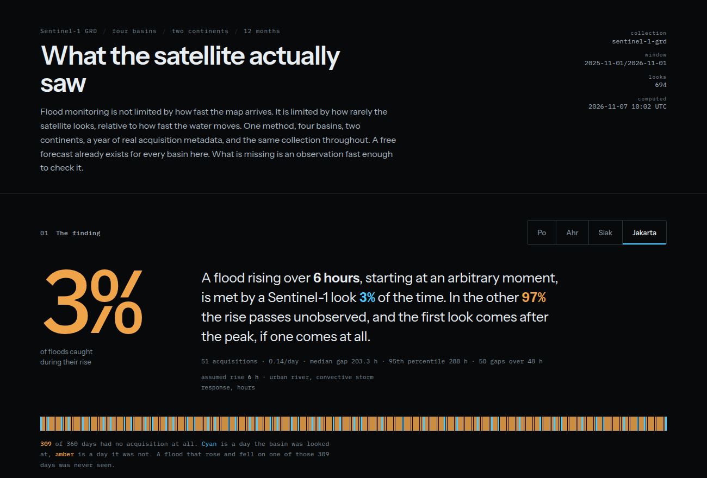
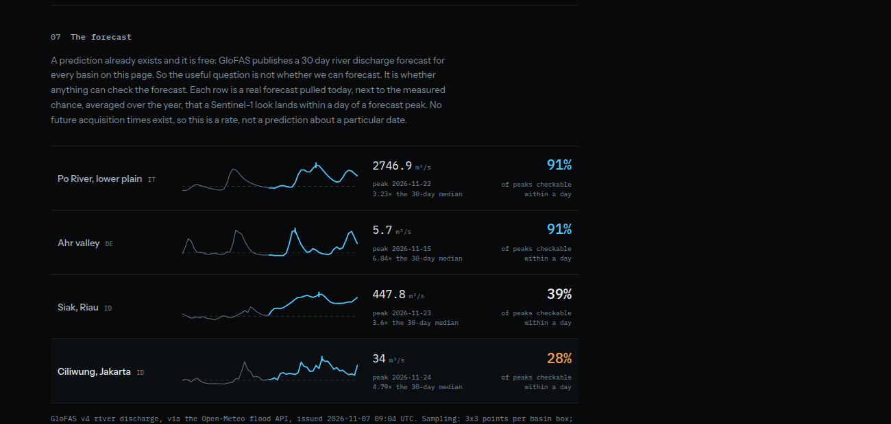

# Flood observation coverage

**Does a satellite actually see a flood while it is rising?**



A flood map tells you where water was. This measures something different: how much
of a flood's rise is ever observed at all, and whether a forecast can be checked.

Measured from one year of real Sentinel-1 acquisition metadata over four basins,
two in Europe and two in Indonesia, plus the current GloFAS discharge forecast.

## The claim

**Flood monitoring is coverage-limited, not latency-limited.**

The maps arrive fast. Copernicus GFM publishes a global 20 m flood layer in under
8 hours for more than 99% of scenes, free and open. The record for a specific event
is 8 hours from service activation (EMSR444, west Ukraine, June 2025), and that
speed came from pre-tasking the SAR off a forecast, not from a faster satellite.

So latency is solved. What is not solved is that the map arrives for a 3 to 6 day
snapshot of a phenomenon that evolves in hours. A flood can begin and end between
two passes, and a conventional dashboard renders that gap as empty space.

The finding, in one line: **a basin can be simultaneously "monitored" and
unwatched.**

## The metric

A flood's rise is a window of hours. The question is whether that window contains
at least one usable Sentinel-1 look.

The probability is computed **empirically**, not modelled. Take the real
acquisition timestamps for a year, slide the rise window across it in one hour
steps, and count how often a look falls inside:

```
P(rise observed) = |{t : a look falls in [t, t + rise_hours]}| / |{t}|
```

This is why the numbers differ from the nominal revisit figure. Passes cluster
hard, so a 6 day revisit does not mean a 6 hour event is observed one time in 24.
The same run also reports the raw gap distribution, so any rise time can be read
off without re-running.

Rise times are assumptions, not measurements, and the page shows the sweep so the
conclusion can be read at 3, 6, 12, 24, 48, 72 and 168 hours instead of resting on
one guess.

## Results

One year, one collection, one method. 694 distinct overpasses across the four
basins.

| basin | looks/yr | looks/day | median gap | 6 h rise seen | 48 h rise seen |
|---|---|---|---|---|---|
| Po, IT | 315 | 0.87 | 24.0 h | 21% | 91% |
| Ahr, DE | 250 | 0.69 | 24.0 h | 17% | 91% |
| Siak, Riau | 78 | 0.22 | 120.1 h | 5% | 39% |
| Ciliwung, Jakarta | 51 | 0.14 | 203.3 h | 3% | 28% |

The constraint is the ratio of cadence to rise time, not latitude.

- **Riau** has a five day median gap, so it catches a week-long peat flood 99% of
  the time and a six hour one 5% of the time.
- **Jakarta** has an eight and a half day median gap, so a flash flood is
  essentially never observed while it is rising.
- **Po and Ahr** have nearly identical cadence (0.87 and 0.69 looks per day, both
  a 24 hour median gap) and land in completely different places: 90% versus 17%.
  Nothing about the satellites changed. The rise time did.

## The forecast layer

GloFAS already publishes a free 30 day river discharge forecast, so predicting is
not the hard part. The question is whether the prediction can be **checked**. Each
forecast peak is paired with the measured chance that a look lands within 24 hours
of it.



| basin | forecast peak | date | vs 30-day median | peak checkable within a day |
|---|---|---|---|---|
| Po | 2746.9 m3/s | 2026-11-22 | 3.2x | 91% |
| Ahr | 5.7 m3/s | 2026-11-15 | 6.8x | 91% |
| Siak, Riau | 447.8 m3/s | 2026-11-23 | 3.6x | 39% |
| Ciliwung, Jakarta | 34.0 m3/s | 2026-11-24 | 4.8x | 28% |

Europe can check its own forecast. Jakarta cannot: for 72% of forecast peaks, no
look lands within a day, so the forecast is issued, acted on, and never verified.

The forecast is sampled on a 3x3 grid per basin and the cell with the highest
median discharge is kept. Sampling the bounding box centre returns headwater cells
(Po centroid 1.8 m3/s against 1124 m3/s on the main stem), which would have
understated every peak.

## Run the demo

```
python3 ingest.py     # pull Sentinel-1 metadata from STAC for four basins (~1 min)
python3 forecast.py   # pull the GloFAS discharge forecast (~10 s)
python3 server.py     # http://127.0.0.1:8765
```

No dependencies beyond the Python standard library. The server is stdlib
`http.server`, the STAC query is `urllib`, and every statistic is computed
server-side in `analyze.py`. The basemap is Esri World Dark Gray, loaded from a CDN
for the locator map only; the temporal analysis does not depend on it.

No API keys, no accounts, no build step.

## Analysing another place

The method is not specific to these four basins. Any bounding box with a known
hydrological response time can be measured, and adding one is a single entry in
`basins.py`:

```python
{
    "id": "elbe",
    "short": "Elbe",
    "name": "Elbe, lower reaches",
    "country": "DE",
    "bbox": [11.00, 53.00, 11.90, 53.60],
    "response": "slow",          # "slow" or "flash"
    "rise_hours": 48,
    "rise_source": "large lowland river, days-scale rise",
}
```

Then re-run `ingest.py` and `forecast.py`. Nothing else changes: both scripts
iterate `BASINS`, `/api/data` and `/api/forecast` serialise whatever is there, and
the page renders one row per basin returned by the API. `response` only decides
which basin is used as the dashed comparator, so that a flash catchment is
compared with another flash catchment rather than with a lowland river.

Two things to know before pointing it somewhere new:

- The bounding box is a **query box, not a catchment**. The result describes the
  acquisition record over that box, so the box should cover the reach you actually
  care about.
- `rise_hours` is an assumption you supply. It is the single biggest lever on the
  answer, which is why the page draws the whole sweep rather than one number
  produced by one guess.

There is no UI for adding a basin. It is a code entry and a re-run, deliberately,
because ingesting a year of metadata for a new area takes about a minute and is
not something to trigger from a browser.

## What this does not tell you

- **No acquisition is not no flood.** A gap means no look, not that water was
  absent. Nothing here should be read as zero.
- **Product latency is not the constraint.** GFM publishes a global 20 m flood
  layer in under 8 hours for more than 99% of scenes. The limit is revisit.
- **SAR has its own errors.** CEMS reports over-detection from water look-alikes,
  and under-detection under dense vegetation, in wind, and in urban areas.
- **Rise times are assumptions.** Order-of-magnitude values, not per-event
  measurements.
- **River discharge only.** GloFAS states it covers rivers, not flash floods,
  coastal flooding or inundation extent, on a 5 km grid that does not resolve small
  steep catchments.
- **No flood threshold.** The forecast peak is the maximum of the forecast window.
  These are discharge figures, not warnings.

## Files

| File | Role |
|---|---|
| `basins.py` | the four basins, their boxes and assumed rise times |
| `ingest.py` | STAC search, deduplication of polarisation pairs to distinct overpasses |
| `analyze.py` | gap statistics and the empirical observation-probability sweep |
| `forecast.py` | GloFAS forecast per basin, and the probability a look can confirm a peak |
| `server.py` | static files, `/api/data`, `/api/forecast` |
| `static/` | page, styles, client rendering |
| `data/` | committed snapshots, so the demo runs without a network round trip |
| `DESIGN.md` | design direction and the reason for each visual decision |

## Evidence

| Document | Contents |
|---|---|
| [docs/01-latency-and-data-landscape.md](docs/01-latency-and-data-landscape.md) | Observation age versus processing latency, the tier model, a catalogue of verified public sources, latency budget arithmetic |
| [docs/02-architecture.md](docs/02-architecture.md) | Reference architecture for serving this at scale: ingest, storage, raster serving, API contract, failure modes |
| [docs/03-method.md](docs/03-method.md) | The method in full: verified latency table, the two limits admitted by the operators, the metric, results, and the sources behind every number |

## Verified facts behind the argument

- **GFM**: under 3 hours best case, under 8 hours for more than 99% of scenes;
  revisit 3 to 6 days depending on location.
- **EMSR444**: first flood extent 8 hours after service trigger, achieved by
  pre-tasking the SAR acquisition off EFAS forecast information.
- **GloFAS**: daily, 51-member ensemble, about 9 km to 15 days and 36 km to 30
  days; rivers only, no flash flood, no coastal, no inundation extent.
- **Sentinel-1**: nominal 6 day revisit at the equator with two satellites; S-1A
  ended 29 June 2026, leaving the C/D configuration.
- **Retirement test**: the S-1A retirement was checked against this data and
  rejected as a cause. Look rate was unchanged (Po 0.87 to 0.86 per day, Siak
  0.22 to 0.23).

Every figure above is sourced in [docs/03-method.md](docs/03-method.md#sources).
